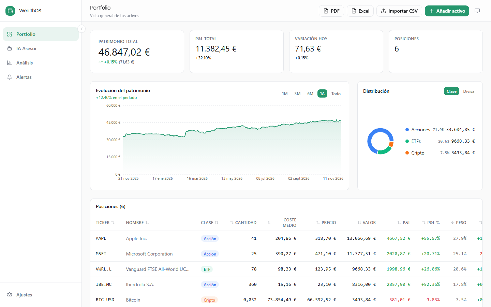
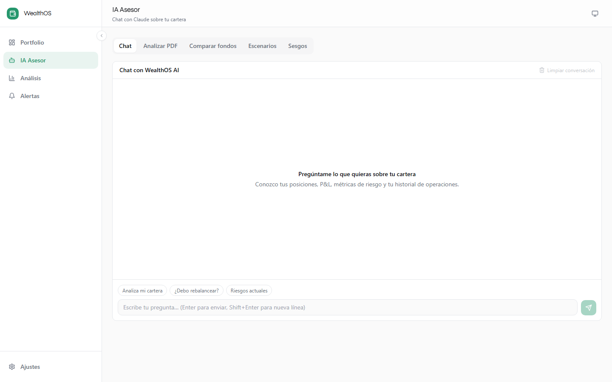
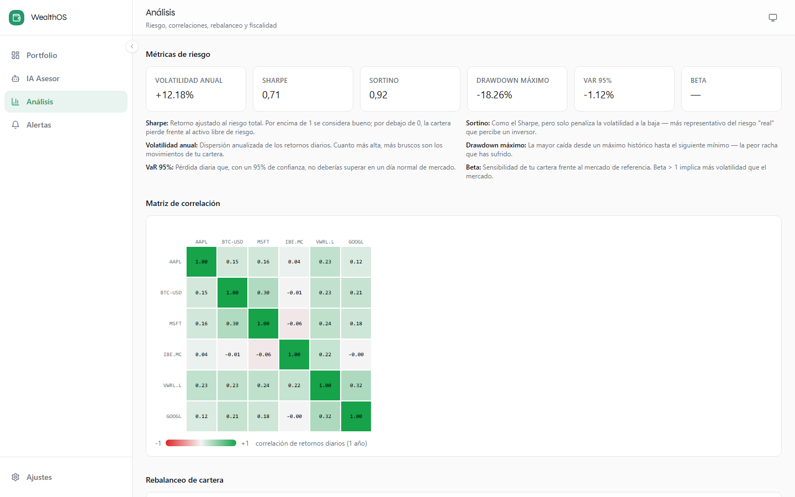
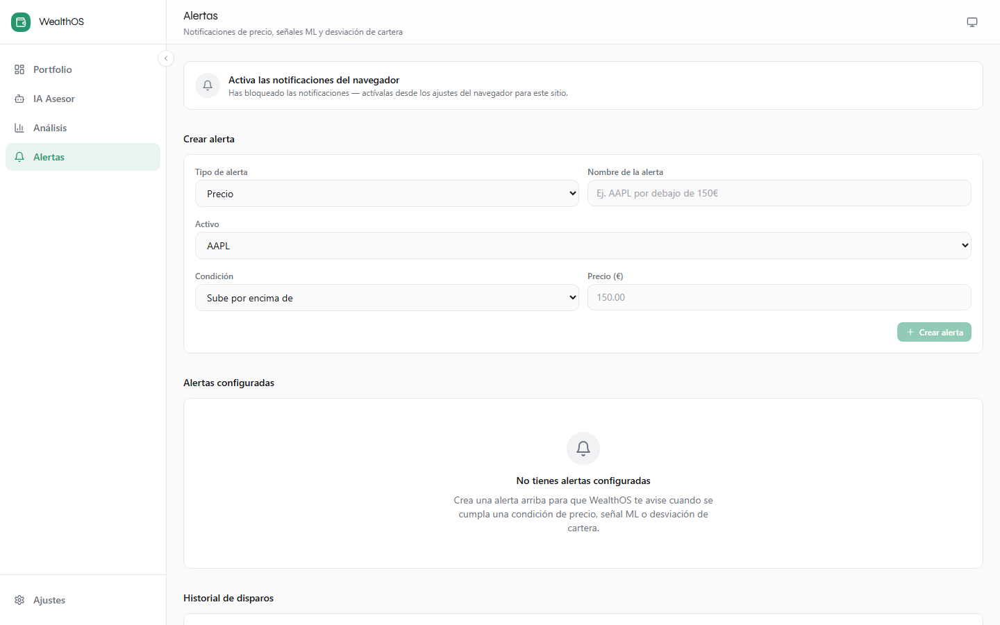
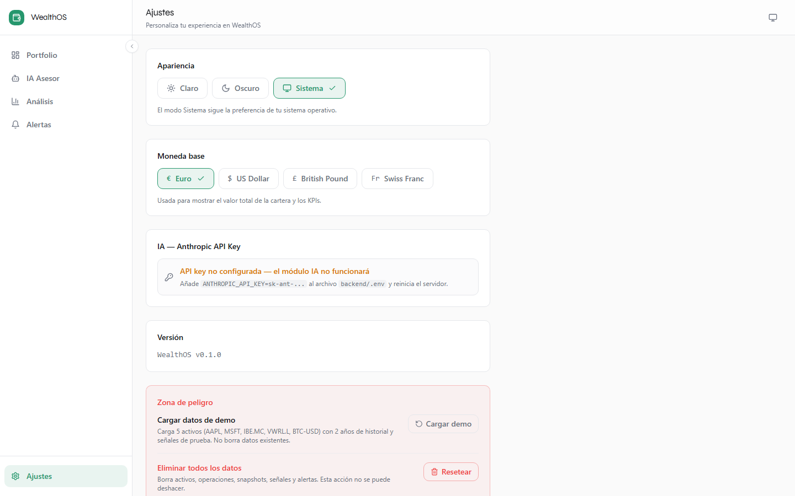

# WealthOS — Personal Investment Platform

Plataforma de gestión de inversiones con IA, modelo ML predictivo y señales de trading. Funciona en local; los datos de mercado son gratuitos.




| IA Asesor | Análisis |
|---|---|
|  |  |

| Alertas | Ajustes |
|---|---|
|  |  |

> Las capturas usan datos de demostración. Para generarlos en tu máquina: `cd backend && python -m app.scripts.seed_demo_data`

## Stack
- **Frontend**: React 18 + Vite + TypeScript + TailwindCSS + shadcn/ui
- **Backend**: FastAPI (Python) + SQLite + Alembic
- **ML**: LightGBM + PyTorch LSTM + SHAP
- **IA**: Anthropic Claude API
- **Datos**: yfinance + OpenBB (gratuito)

## Arranque rápido

### Requisitos
- Docker + Docker Compose
- Node.js 20+ (para desarrollo sin Docker)
- Python 3.11+ (para desarrollo sin Docker)

### Con Docker (recomendado)

```bash
# 1. Copia el archivo de entorno
cp .env.example .env

# 2. Añade tu API key de Anthropic en .env
ANTHROPIC_API_KEY=sk-ant-...

# 3. Levanta todo
docker compose up

# Frontend:  http://localhost:5173
# Backend:   http://localhost:8000
# API docs:  http://localhost:8000/docs
```

### Sin Docker (desarrollo local)

**Frontend:**
```bash
cd frontend
npm install
npm run dev
```

**Backend:**
```bash
cd backend
python -m venv .venv
source .venv/bin/activate   # Windows: .venv\Scripts\activate
pip install -r requirements.txt
uvicorn app.main:app --reload --port 8000
```

**ML worker** (solo cuando necesites entrenar modelos):
```bash
docker compose --profile ml up ml-worker
```

## Estructura del proyecto

```
wealthos/
├── frontend/                # React + Vite
│   └── src/
│       ├── components/
│       │   ├── ui/          # Componentes base (MetricCard, SignalBadge...)
│       │   ├── layout/      # AppLayout, PageHeader, Sidebar
│       │   ├── charts/      # TradingView, Recharts wrappers
│       │   ├── portfolio/   # Posiciones, P&L, distribución
│       │   ├── ai/          # Chat, comparador, analizador PDF
│       │   └── trading/     # Señales, predicciones, backtesting
│       ├── pages/           # Una por ruta
│       ├── hooks/           # Custom hooks (usePortfolio, useSignals...)
│       ├── lib/             # api.ts, utils.ts
│       ├── store/           # Zustand global state
│       └── styles/          # globals.css (tokens Tailwind)
│
├── backend/                 # FastAPI
│   └── app/
│       ├── api/routes/      # portfolio, assets, ai, ml, alerts
│       ├── core/            # config, security
│       ├── db/              # session, base
│       ├── models/          # SQLAlchemy models
│       ├── schemas/         # Pydantic schemas
│       └── services/        # business logic
│
├── ml/                      # Modelo predictivo
│   ├── notebooks/           # Exploración y experimentación
│   └── src/
│       ├── features/        # Feature engineering
│       ├── models/          # LightGBM + LSTM
│       └── signals/         # Generación de señales
│
└── docker-compose.yml
```

## Variables de entorno

```env
# .env (en la raíz)
ANTHROPIC_API_KEY=sk-ant-...
DATABASE_URL=sqlite:///./data/wealthos.db
ENVIRONMENT=development
```

## Aviso

Proyecto personal con fines educativos. Las señales y análisis **no son asesoramiento financiero**.

## Licencia

MIT
